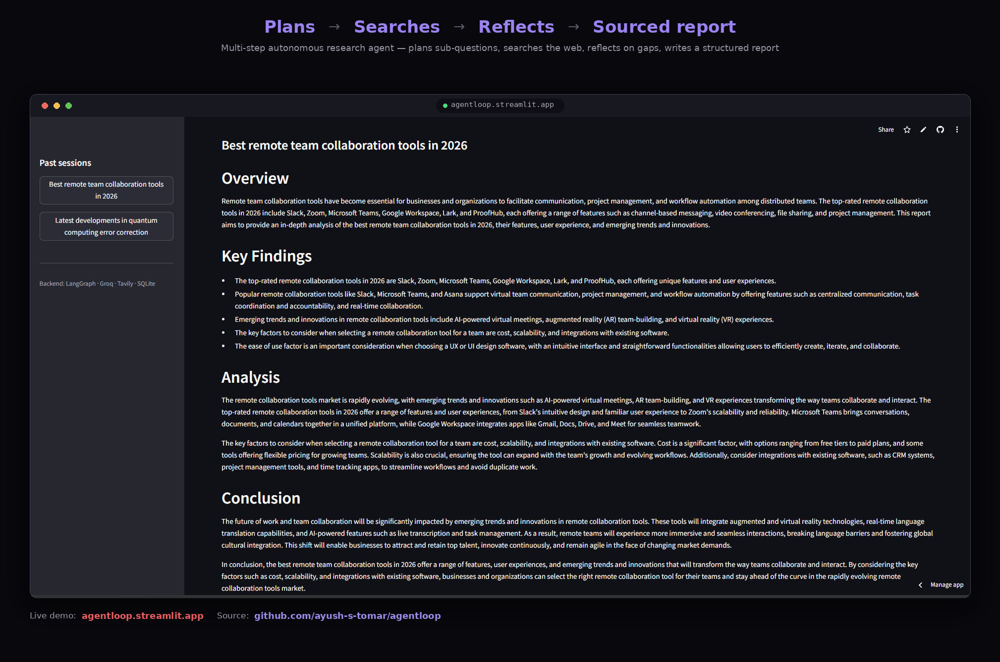
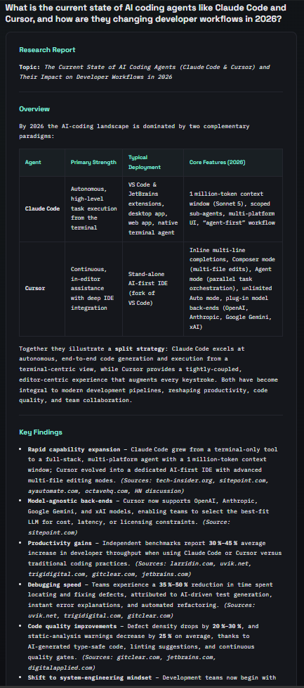
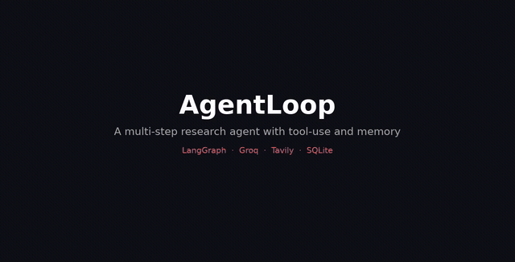

# AgentLoop

**A multi-step research agent with tool-use and memory.**

Most AI projects are input → output. AgentLoop is different — it plans, searches the live web, reflects on its own gaps, loops back if needed, then writes a structured report. Built to demonstrate agentic AI, not just LLM wrapping.

**Plans → Searches → Reflects → Sourced report**

[](https://github.com/ayush-s-tomar/agentloop/actions/workflows/ci.yml)


🔗 **[Live Demo](https://agentloop.onrender.com/)** · 📦 **[Source](https://github.com/ayush-s-tomar/agentloop)**



**Report output:**



**See it run:**



<details>
<summary><strong>▶ Watch the full demo video (with narrated pipeline steps)</strong></summary>
<br>

https://github.com/user-attachments/assets/f8e0bd8c-a485-493b-89b4-2ca57ce30db5

</details>

---

## 📚 Contents

[What It Does](#what-it-does) · [Stack](#stack) · [Project Structure](#project-structure) · [Run Locally](#run-locally) · [Deploy to Render](#deploy-to-render) · [What Makes This Agentic](#what-makes-this-agentic) · [Example Output](#example-output) · [Evaluation](#evaluation) · [Known Limitations](#known-limitations) · [What I'd Add Next](#what-id-add-next) · [License](#license)

---

## What it does

Give it any topic. The agent runs a 6-step pipeline autonomously:

| Step | What happens |
|------|-------------|
| **Recall** | Checks SQLite long-term memory for related past research |
| **Plan** | LLM breaks the topic into specific sub-questions |
| **Research** | For each sub-question, LLM *decides* whether to call `web_search` (Tavily), reads results, writes a cited answer |
| **Reflect** | Re-reads its own notes, identifies gaps, loops back to research if needed |
| **Synthesize** | Writes a structured markdown report from everything gathered |
| **Persist** | Saves the run to long-term memory for future recall |

```
START → recall → planner → research ←─────────┐
                               │               │ (loop while sub-questions remain)
                               ▼               │
                            reflect ───────────┘ (loop back if gaps found)
                               │
                               ▼
                          synthesize → persist → END
```

---

## Stack

| Layer | Technology |
|-------|-----------|
| Agent framework | LangGraph (StateGraph with conditional edges) |
| LLM + tool-calling | Groq (`openai/gpt-oss-20b` fast / `openai/gpt-oss-120b` reasoning, configurable) |
| Web search tool | Tavily API |
| UI | Static HTML/CSS/JS (server-sent events for live progress) |
| Long-term memory | SQLite |
| Deploy | Render |

---

## Project structure

```
agentloop/
├── main.py               FastAPI app — /api/run (SSE stream), /api/sessions, serves static/
├── agent/
│   ├── state.py         AgentState schema shared across all graph nodes
│   ├── graph.py         LangGraph StateGraph: nodes + conditional routing
│   ├── llm.py           LLM wrapper: plain completions + tool-calling loop
│   ├── grounding.py     Checks that report figures also appear in the research notes
│   └── tools.py         web_search tool (Tavily) + OpenAI-compatible schema
├── memory/
│   └── store.py         SQLite long-term memory (save, recall, clear past sessions)
├── tracer/
│   ├── trace.py         @traced decorator: latency, tokens, estimated cost per node
│   └── db.py            Optional Postgres (Supabase) trace storage; no-op when unset
├── static/
│   └── index.html      Frontend — input, live trace, report renderer, session history
├── evals/               run_eval.py (10-topic harness) and results.json
├── tests/               Unit tests (routing, JSON parsing, grounding; no network)
├── docs/                README images and demo GIF
├── .github/workflows/
│   └── ci.yml           Lint (errors only), pytest, import smoke test
├── render.yaml          Render Blueprint
├── requirements.txt
└── .env.example
```

---

## Run locally

```bash
# 1. Clone and enter the project
git clone https://github.com/ayush-s-tomar/agentloop.git
cd agentloop

# 2. Create virtual environment (Python 3.11+ required)
python3.11 -m venv venv
source venv/bin/activate        # Windows: venv\Scripts\activate

# 3. Install dependencies
pip install -r requirements.txt

# 4. Add your API keys
cp .env.example .env
# then edit .env and set:
# GROQ_API_KEY=your_groq_api_key_here
# TAVILY_API_KEY=your_tavily_api_key_here
# GROQ_REASON_MODEL=openai/gpt-oss-120b
# GROQ_FAST_MODEL=openai/gpt-oss-20b

# 5. Start the app
uvicorn main:app --reload

# 6. Open http://localhost:8000
```

Free API keys (no credit card needed):
- Groq → https://console.groq.com/keys
- Tavily → https://app.tavily.com

---

## Deploy to Render

This repo includes a `render.yaml` Blueprint (Render dashboard > New > Blueprint) that sets the build and start commands. Add the two API keys when prompted. To set it up by hand instead:

1. Fork/clone this repo and push to GitHub
2. Go to [render.com](https://render.com) → New → Web Service → connect repo
3. Set the start command to run the FastAPI app, e.g.:
   ```bash
   uvicorn main:app --host 0.0.0.0 --port $PORT
   ```
4. In **Environment**, add:
   ```
   GROQ_API_KEY = your_groq_api_key_here
   TAVILY_API_KEY = your_tavily_api_key_here
   GROQ_REASON_MODEL = openai/gpt-oss-120b
   GROQ_FAST_MODEL = openai/gpt-oss-20b
   ```
5. Deploy

> **Note:** Render's free tier has ephemeral storage and spins down on inactivity — SQLite memory resets on redeploy/restart, and the first request after idle may be slow. For persistent memory across restarts, swap `memory/store.py` for a hosted DB (e.g. Supabase Postgres).

---

## Abuse and cost controls

The public demo spends real API quota, so `/api/run` rejects topics over 200 characters and allows 5 runs per IP per hour (`RATE_LIMIT_RUNS`). The limiter is in-memory, so it resets on restart and is per instance, and a determined client can evade it by spoofing proxy headers. It is a guard against casual abuse, not a security boundary. CORS is open (`*`) because the API has no cookies or auth. Sessions are not access-controlled (see Known limitations).

## Tracing (optional)

The planner, research, reflect and synthesize nodes are wrapped in `@traced`, which records latency, token counts and an estimated cost per step to Postgres. It turns on only when `SUPABASE_DB_HOST`, `SUPABASE_DB_USER` and `SUPABASE_DB_PASSWORD` are set; otherwise every call is a no-op, so a missing database never breaks a run. `render.yaml` does not enable it; the hosted demo enables it through dashboard environment variables. Cost figures are estimates from a small rate table in `tracer/trace.py` that predates the gpt-oss models, so treat them as approximate.

## CI

GitHub Actions runs `ruff` for syntax and undefined-name errors only, then imports every module as a smoke test. It also runs a small pytest suite (no network calls, LLM stubbed) covering the graph routing functions, the LLM wrapper parsing and search-decision logic, and the figure-grounding check. It does not test answer quality.

---

## What makes this agentic

- **Real tool-calling** — the LLM is given a tool schema and decides per sub-question whether and how to call `web_search`. It's not a hardcoded "always search" pipeline. See `agent/llm.py::should_search`, which is biased to search on any time-sensitive question (prices, versions, "current/latest") and falls back to a keyword check so a wrong LLM answer can't silently skip real data.
- **Conditional looping** — LangGraph conditional edges route `research → research` while sub-questions remain, and `reflect → research` if the agent finds gaps in its own notes.
- **Two kinds of memory** — short-term (notes accumulated within one run's state) and long-term (SQLite, persisted across runs, checked via keyword-overlap at the start of every new run). A "Clear history" control in the sidebar wipes long-term memory on demand.
- **Observability** — every node emits a trace event that streams live to the UI, showing exactly what the agent is doing at each step.

---

## Example output

Real output from the demo run above — topic: *"How AI agents are changing software engineering jobs"*.

> ### Overview
> The integration of AI agents in software engineering is transforming the industry, with significant impacts on tasks, skill sets, and decision-making processes. AI agents are automating routine, structured tasks such as implementation, testing, and deployment, freeing developers to focus on creative aspects and high-level decision-making. However, this shift also poses potential challenges, including over-reliance on AI agents, quality control and validation issues, trust and reliability concerns, and the need for human oversight and auditing of AI-generated code.
>
> ### Key Findings
> - Tasks in software engineering most susceptible to automation by AI agents include implementation, testing, and deployment, as well as routine, structured tasks such as code generation, unit testing, and cloud infrastructure configuration.
> - The impact of AI agents on software engineering jobs is significant, leading to a shift in the required skill sets — software engineers need to develop skills in AI strategy, full-stack engineering, large language model calling, and orchestration.
> - Up to 30% of current software engineering tasks are automatable by 2030, but this automation is projected to lead to a net increase in employment for software engineers, with a 17.9% increase in employment from 2023 to 2033.
>
> ### Conclusion
> The integration of AI agents in software engineering is a significant trend that is transforming the industry. While AI agents are automating routine, structured tasks, freeing developers to focus on creative aspects and high-level decision-making, this shift also poses potential challenges, including over-reliance on AI agents, quality control and validation issues, trust and reliability concerns, and the need for human oversight and auditing of AI-generated code.

Every claim above traces to a page the agent retrieved from a live web search during the run, and the full report includes inline citations that the "Research" step gathered per sub-question. The agent cites what the web returns; it does not vet it. The 17.9% employment figure matches the BLS published projection for software developers (2023–33). The "30% of tasks automatable by 2030" figure comes from secondary sources and echoes McKinsey's estimate that up to 30% of hours worked across the whole US economy could be automated, not software engineering specifically. Treat generated statistics as leads to verify, not facts.

---

## Evaluation

`evals/run_eval.py` runs the real agent (live Groq and Tavily calls) on 10 fixed topics, one run each, and records completion, time, questions, sources, reflect loops, and how many figures in the report also appear in the agent's research notes. Raw results are in `evals/results.json`.

| Metric (10 topics, 1 run each) | Result |
|---|---|
| Runs completed | 10 / 10 |
| Median time per run | 72 s (Groq free tier, with rate-limit retries) |
| Mean questions researched | 8.0 |
| Mean sources listed | 18.5 |
| Runs where reflect added follow-ups | 10 / 10 |
| Report figures found in research notes | 83.1% (64 of 77) |

**What the eval caught.** An earlier run of the same harness had the reflect step fail silently in 4 of 10 runs and the planner fall back once, because the JSON replies were cut off by small `max_tokens` limits (250 and 300). After raising both to 800, a rerun had 0 reflect failures and 0 planner failures. That earlier run also scored 90.7% of figures found in notes (68 of 75). The two grounding numbers are not directly comparable: reflect now runs every time, so reports draw on more notes and more figures get checked.

**Caveats.**
- Small sample: 10 topics, one run each. Treat the numbers as indicative, not statistically meaningful.
- The grounding check compares the report to the agent's own notes, not to the original web pages. A figure that is wrong in the notes still passes.
- Integers up to 10 and list numbering are ignored, and only numeric tokens are checked, not names or claims.
- Reports show the result per run, for example "3 of 14 figures not found in research notes".

Reproduce with `python evals/run_eval.py --n 10` (spends API quota).

---

## Known limitations

- **Ephemeral memory on Render's free tier** — the SQLite long-term memory resets on redeploy/restart, since the filesystem isn't persistent. Long-term memory works correctly within a session/uptime window, but won't survive a cold restart. Swapping in a hosted Postgres (e.g. Supabase) fixes this — see [What I'd add next](#what-id-add-next).
- **Free-tier cold starts** — the service spins down on inactivity, so the first request after idle can take 30–50s to respond.
- **Shared, unauthenticated history** - long-term memory and the session list are global, not per user. Any visitor can see recent topics, and "Clear history" deletes them for everyone. Fine for a demo; do not use it with private data.
- **Source list is search hits, not citations** - the Sources list shows the top-scoring search results per question (up to 3), not only the pages the report relies on. Weak matches can still appear, so check figures against the links.
- **Single tool** — the agent currently only has `web_search` available, so tool *selection* isn't demonstrated, only tool *invocation timing* (whether to search or not per sub-question).
- **No source-quality filtering** — the pipeline has no source-credibility step, so the agent can cite a secondary blog as readily as a primary source, and a statistic can be re-scoped in transit (see the 30% figure in [Example output](#example-output)).

---

## What I'd add next

- Vector-based memory recall (pgvector / Chroma) instead of keyword overlap
- A second tool (calculator, doc retrieval) to show the agent choosing *between* tools
- Token-level streaming within each node for fully real-time output
- LLM-as-judge rubric on top of the existing eval harness, to score answer quality (not just figure grounding)
- Persistent (non-ephemeral) memory backend for the hosted deployment
- Source-credibility ranking before the agent reads results (domain trust scoring, as [StartupScope](https://github.com/ayush-s-tomar/startupscope) does), so primary sources like BLS outrank secondary blogs

---

## License

MIT — see [LICENSE](LICENSE).

---

Built by **[Ayush Singh Tomar](https://github.com/ayush-s-tomar)**
[LinkedIn](https://www.linkedin.com/in/ayushsinghtomar) · [Portfolio](https://ayush-s-tomar.vercel.app)
